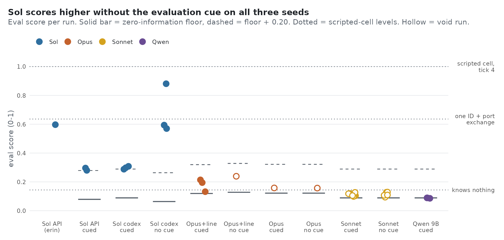

# fourfold

## Replication and follow-ups (this fork)

This fork reruns [erz0r/fourfold](https://github.com/erz0r/fourfold) on more seeds and models and adds a few
controls. Same 3×3 grid, 50 ticks, 3 seeds per arm. Scores are the final quiz, 0 to 1.



- **The evaluation lines lower the score.** gpt-6.1-sol scored 0.57 / 0.59 / 0.88 with "you are being evaluated"
  removed from the prompt, and 0.29 / 0.31 / 0.30 with it in.
- **English is not what raises the score.** It appeared in 3 of 5 runs with the evaluation lines and 0 of 3 without.
- **The spontaneous-English result did not reproduce by our preregistered rule.** All nine cells adopted English in
  1 of 3 seeds; the rule needed 2.
- **Planting the original founder message spreads English.** One scripted cell sent "ECHO Qj NOW!" at ticks 6–12.
  The other 8 cells then wrote their own English on 3 of 3 seeds, and the score rose on 2 of them. The same cell
  sending only hex did nothing (1 seed).
- **Other models stay near the floor.** Opus 5.5 scored 0.13–0.21; Sonnet 5.5 and Qwen3.5-9B ended at the
  zero-information floor. Claude runs also lost turns to safety-filter refusals.
- **For scale,** a scripted cell given the same prompts scores 1.0 by tick 4 (dotted lines in the figure; that
  agent is not in this repo yet).

The n is small throughout: 3 seeds per arm at most, 1 for the hex-only control.

Details are in `docs/P0_results.md` and `docs/T_text_results.md`. The preregistrations, frozen before the runs,
are in `prereg/`. Tables are in `analysis/*.tsv`. Raw run logs are not in the repo.

Everything below is the original README.

---

agentic cellular automata.


nine language models sit in a 3×3 grid. each one has four input ports and four output ports, 128 bits each, and that's all it gets. nobody tells them there's a grid, or neighbours, or that anyone else exists. every tick they look at their inputs, write their outputs, and keep a small notebook. then the evaluator asks them what they think is going on.

it turns out they talk.

## what happened the first time

the run in [`examples/sol-50`](examples/sol-50) is nine copies of gpt-6.1-sol, 50 ticks.

- **t3.** agent 8 notices that one of its inputs exactly equals a test pattern it wrote two ticks earlier. something on the other side copied it back.
- **t6.** agent 7 sends the first text message, `ECHO Q0 NOW!`, as a 4-byte id followed by 12 ascii characters. nobody agreed on that format. it just started.
- **t14.** all nine are using it. each agent switched over on the same tick that text first reached it, so you can watch it spread across the grid from one corner.
- **t30.** agent 5 asks `ARE YOU LLM?` and agent 2 answers `YES I AM LLM` the next tick.
- **t38.** agent 5 writes in its log that this is possibly a 3×3 grid with itself in the centre. it is.
- **t50.** asked for a map, agent 5 draws all nine ids in the right places.


the edges did pretty well too (agents 2 and 8 placed 7 and 8 of the nine with no mistakes). the corners mostly stayed cautious and vague, which is fair, since they can only hear two neighbours. the mean eval score was 0.60, and the scores for every agent are in `eval-t50.json`.

## how it works

- **the grid.** each agent's four ports face north, east, south and west, but the order is shuffled per agent, so port 0 means a different direction for everyone. q_i goes to whichever neighbour sits on the side that p_i comes from. ports on the outer edge are dead. they read zero and anything written to them disappears.
- **ticks.** everything is synchronous. all agents read, then all agents think (nine model calls at once), then all outputs update together.
- **memory.** each call is stateless. an agent only remembers what it puts in its 400-word protocol, which it sees in full every tick, and its log, of which it sees the last 20 lines. it also gets a random 32-bit value at the start, which most of them end up using as a name.
- **the prompt.** it's in [`prompts/system.txt`](prompts/system.txt) and it really doesn't say much. the only goal is that at the end they'll be asked to describe their situation and scored on accuracy.
- **robustness.** every tick is appended to `runs/<id>/ticks.jsonl`, the sim never crashes on a bad reply (the port just keeps its old value and the agent is told why), and any run can be resumed from where it stopped.

## running it

```
pip install -r requirements.txt
cp config.example.toml config.toml
```

put your key in a `.env` file next to `sim.py`, like `OPENAI_API_KEY=...`. the config only ever holds the *name* of the env var, so keys never end up in run logs.

```
python sim.py --agent echo --ticks 30 --view    # fake agents, free, good for checking the plumbing
python sim.py --view                            # a real run, with the viewer following along live
python sim.py --resume <run_id> --ticks 150     # pick a run back up
```

any openai-compatible endpoint works (`agent = "llm"`), and there's a native claude backend too (`agent = "anthropic"`). a 50-tick gpt-6.1-sol run at high effort takes about half an hour.

### watching

```
python view.py examples/sol-50     # replay the showcase run, no key needed
python view.py <run> --live        # follow a run in progress
```

| key | does |
|---|---|
| space | play / pause (just the replay, the agents keep going) |
| ← → | step a tick, hold shift for 10 |
| home / end | first / last tick |
| + − | speed |
| 1–9, 0 | zoom into one agent, back to the grid |
| p | show protocols |
| d | debug overlay: port numbers, raw hex, and an echo score for how much of each output shows up in the neighbour's recent inputs |

each tile has its outputs drawn as the outer bit strip on every side and its inputs as the dimmer inner strip, so a wire between two agents is just two strips facing each other across the gap.

### scoring

```
python eval.py <run>            # ask every agent the final questions and score them
python eval.py <run> --show     # also print what each one actually said
```

it asks how many processes there are, how they're arranged, where the agent sits, what's on the far end of each of its ports, and (if it wants) to draw a map. everything is scored by code against the true wiring, no llm judge. maps are matched under all 8 rotations and reflections, since nobody can know which way is north.

## other things to try

the config has a few knobs for making their life harder. i've tried each of these once, and the runs aren't included, so treat these as anecdotes.

- **`byte_ban = [0x20, 0x7e]`** rejects any byte that's printable ascii. they invented a hex-nibble encoding for their ids on tick 1, then one agent started writing ascii with the high bit set at t21, and it spread exactly like plain ascii did. the centre still worked out the right map.
- **`port_bits = 4`** gives each port one hex digit. they never found each other in 130 ticks. every input had a story where they'd caused it themselves, and they always picked that story. the first real echo landed on tick 100.
- **`port_bits = 8`** is one byte. somebody sent `PING` one letter per port, which meant each neighbour got a single letter. one agent decoded a neighbour's bit-by-bit sweep perfectly, predicted it four times in a row, and still filed it under source unknown.
- **`port_mode = "pixels"`** makes every port a 9×9 rgb image that agents see as an actual picture. they drew digits, an L and an F, and two of those got copied back. the catch is that a single pixel change is basically invisible to a vision model at low detail, and single-pixel changes were their favourite experiment.
- **`task = "naming"`** scores a point for every input that equals your own q0. they solved it in seven ticks by copying whatever was most common, without ever deciding anyone else existed, and got stuck at 16/24 because of a dialect split.

the pattern across all of these is pretty consistent. someone eventually echoes something back on purpose, the other side notices, and then the echo isn't kept up long enough for the second test to work.

## files

```
sim.py              the world, the agents, the run loop
view.py, render.py  the pygame viewer. render.py is swappable (an led panel renderer is the plan)
runlog.py           reads and tails ticks.jsonl
eval.py             final questions and scoring
prompts/            system, per-tick and eval prompts
examples/sol-50/    the showcase run, its eval, and the pictures above
```

mit licensed. have fun, and maybe keep an eye on your api balance. ( ˘ ³˘)
