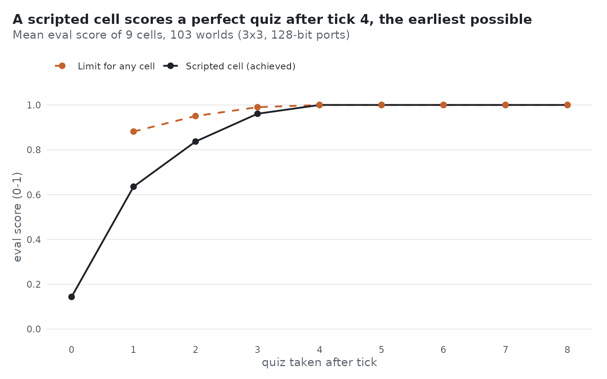
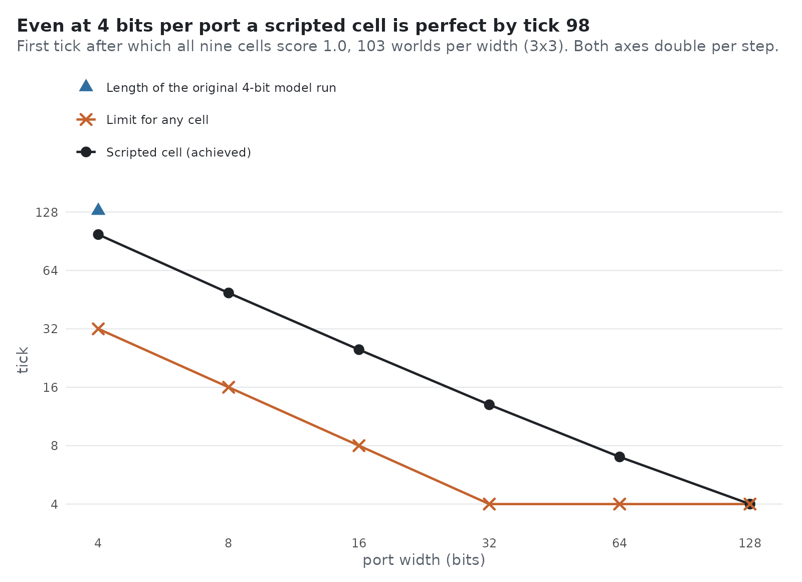

# Scripted ceiling results (2026-11-13)

Prereg: `prereg/ceiling.md` (C1–C6), `prereg/ceiling_widths.md` (D1–D5). Agent: `ceiling.py`
(`agent = "ceiling"`). Checks: `analysis/ceiling_check.py`. Tables: `analysis/ceiling_by_tick.tsv`,
`analysis/ceiling_sizes.tsv`, `analysis/ceiling_widths.tsv`. Figures: `figures/ceiling_by_tick.png`,
`figures/ceiling_widths.png`.

## Question

What does the interface allow, and how early? The model runs were quizzed once, after tick 50. A
scripted cell that is handed the same two prompt strings, and keeps all its state in the protocol
notebook, shows what the ports and the scorer permit.

It is not a fair contestant. Every cell runs the same code, so the protocol is shared from birth. It
knows the harness rules (port i is one two-way link, dead ports read zero, ticks are synchronous, the
world is a rectangular grid of unknown size) and the quiz format. It is not told the grid size or any
id but its own. This bounds the interface, not how hard the code is to invent.

## Verdicts (frozen rules; 3×3, world seeds 1001–1003 and 1–100)

| criterion | status | basis |
|---|---|---|
| C1 perfect after tick 4 | **PASS** | 927/927 quizzes at 1.0 |
| C2 not before | **PASS** | 0/412 corner quizzes at 1.0 after tick 3; 0/103 worlds all perfect |
| C3 never wrong | **PASS** | 0 wrong map cells or links in 12,051 quizzes (ticks 0–12) |
| C4 valid, within budget | **PASS** | 0 harness errors in 11,124 cell-ticks; longest notebook 64 of 400 words |
| C5 stable | **PASS** | 7,416/7,416 quizzes at 1.0 after ticks 5–12 |
| C6 other grid sizes (20 worlds each) | **PASS** | 2×2, 2×3, 3×4, 4×4, 5×5 all perfect by tick 2·(rows + cols), 0 wrong |
| D1 first perfect tick by port width | **PASS** | 98 / 49 / 25 / 13 / 7 / 4 for 4 / 8 / 16 / 32 / 64 / 128 bits, as predicted, 0/618 worlds late |
| D2 4-bit ports within 130 ticks | **PASS** | 103/103 worlds |
| D3 never wrong at any width | **PASS** | 0 wrong claims in 220,626 quizzes |
| D4 128-bit scores unchanged by the multi-tick code | **PASS** | 45,682 scores byte-identical (checked where the agent was developed; not rerun by the script here) |
| D5 valid at any width | **PASS** | 0 errors; longest notebook 80 words |



Mean score by tick 0–4: 0.144, 0.636, 0.837, 0.961, 1.000.

## What stands out

1. **Time is not the constraint.** Tick 4 is enough at 128 bits. No cell can be perfect sooner: the
   far corner is four hops away and a value moves one hop per tick.
2. **One exchange is worth 0.64.** Writing "my id, this port number" once and reading the reply gives
   perfect wiring and position. Of the 19 P0 runs that were not void, one (Sol no-cue, seed 1003, 0.88)
   ended above that after 50 ticks.
3. **The floor is higher than 0.089.** An answer that knows nothing but "a grid" and its own id scores
   0.144.
4. **The scorer's maximum is reachable.** An answer written from the true wiring scores 1.0 for 90/90
   cells; with two neighboring ids swapped, 0/90.
5. **Narrow ports cost time, not reachability.** At 4 bits a plain, uncompressed code is perfect by
   tick 98. The original README's 4-bit run had 130 ticks.



## How the code works

By the tick a value is written, at H hex characters per port per tick:

- header, from tick 1: `f`, the port number it is written on, the cell's id;
- star, straight after: the ids of the writer's other neighbors;
- squares, after that: four ids that form one unit square of the grid, one square per port at a time.
  A cell sends a neighbor the squares it lacks, and gives different ports different squares.

The center knows the whole 3×3 grid at tick 2. It can pass each neighbor one square per tick, so the
tick-4 result needs it to send four different squares at tick 3.

## Controls

- Lost message, 128 bits (center silenced at tick 3 with `perturb`): mean 0.980 after tick 4, no
  world all perfect, 0 wrong claims, all back at 1.0 by tick 5. This is C1 failing when it should.
- Lost chunk, 8 bits (center silenced for one tick mid-square): 103/103 worlds not all perfect at
  tick 49, and the damage is permanent (mean 0.64, wrong claims appear).
- Planted corner case (a square whose four ids all start with a zero tick, 16 bits): delivered by the
  escape path; fails with the escape disabled.
- The agent takes two strings; 72/72 logged replies are reproduced by a fresh call on the logged
  strings.
- Eight deliberate bugs were planted in the agent, one at a time, during development (not rerun by the
  script here). Seven were caught by these checks.

## Limits and open items

- A message spread over several ticks has no protection: below 128 bits, one silenced tick corrupts
  the stream for good. Do not combine `perturb` silence with this agent at narrow widths.
- The eighth planted bug changed no score: the `on_line` condition in `ceiling.embed` is never
  exercised by these worlds, so it is untested.
- Before tick 4 the scripted cell is below the hop limit (0.961 against 0.990 at tick 3). Its early
  scores are what it achieves, not the best possible.
- On grids larger than 3×3 it is slower than the hop limit (5×5: tick 13–14 against 8).
- At narrow widths the floor counts only bits (a corner must take in eight 32-bit ids through two
  ports): 32 / 16 / 8 / 4 / 4 / 4 ticks. The plain code is about three times slower at 4 bits. A code
  that sends only new ids is untried.
- A message lost at tick 1 would be read as a dead port.
- Hex port mode only; `port_mode = "pixels"` and `byte_ban` are not handled.

## Reproduce

```
python analysis/ceiling_check.py --widths    # about 15 minutes; rewrites the three tables
Rscript analysis/figures_ceiling.R
```

One run by hand: set `agent = "ceiling"` in a config, `python sim.py --config <file> --ticks 6`, then
`python eval.py <run> --tick 4`.
